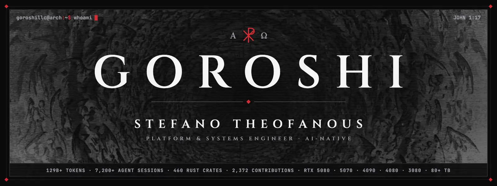

<p align="center">
  
</p>

<div align="center">

**Platform & Systems Engineer · Founder, Goroshi LLC**

Rust-first systems, AI agent infrastructure, and exact-to-the-cent financial tooling.

</div>

```text
NAME      :: Stefano Theofanous
ROLE      :: Founder & Systems Engineer, Goroshi LLC
FOCUS     :: multi-agent engineering platforms · financial reconciliation · GPU compute
AGENTS    :: 9,000+ AI agent sessions run · 6,100+ orchestrated subagents
TOKENS    :: 152B+ tokens processed across Claude, Codex, Copilot, Antigravity, OpenCode and local models (measured Oct 27 2026)
SCALE     :: 383+ Rust crates in one workspace · 284+ repositories
METAL     :: hand-written GPU compute kernels in Rust on Apple Metal (294 GB/s, 2.8 TFLOP/s FP32 measured)
SOURCE    :: private. Architecture reviews and live walkthroughs on request.
STATUS    :: open to engineering roles and platform engagements
```

### Stack

<div align="center">

**Languages**


**Infrastructure**


**Data & Compute**


**AI Engineering**


</div>

---

<div align="center">

**[goroshillc.com](https://goroshillc.com/) · [LinkedIn](https://www.linkedin.com/in/stefano-theofanous) · contact@goroshillc.com**

<sub>Colossians 3:23 · Α ☧ Ω · ICXC NIKA</sub>

</div>
