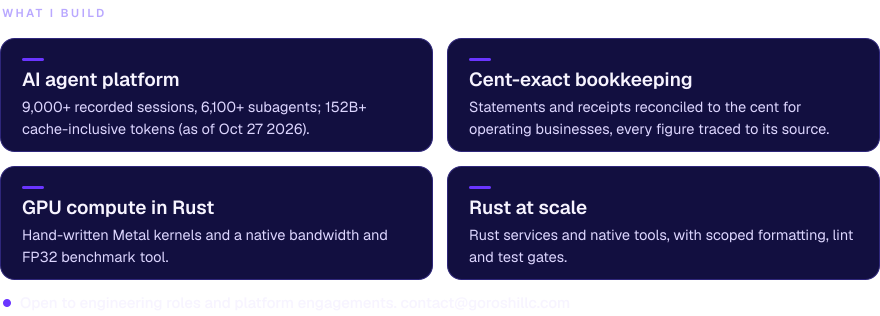
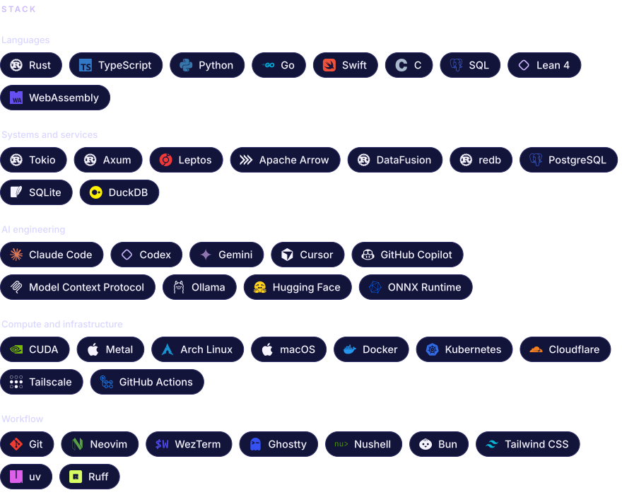

  <picture>
    <source media="(prefers-color-scheme: dark)" srcset="assets/banner-dark.svg">
    <source media="(prefers-color-scheme: light)" srcset="assets/banner-light.svg">
    
  </picture>

<picture><source media="(prefers-color-scheme: dark)" srcset="assets/glance-dark.svg"><source media="(prefers-color-scheme: light)" srcset="assets/glance-light.svg"></picture>

<picture><source media="(prefers-color-scheme: dark)" srcset="assets/stack-dark.svg"><source media="(prefers-color-scheme: light)" srcset="assets/stack-light.svg"></picture>

  <a href="https://goroshillc.com/"><picture><source media="(prefers-color-scheme: dark)" srcset="assets/link-site-dark.svg"><source media="(prefers-color-scheme: light)" srcset="assets/link-site-light.svg"></picture></a>&nbsp;
  <a href="mailto:contact@goroshillc.com"><picture><source media="(prefers-color-scheme: dark)" srcset="assets/link-email-dark.svg"><source media="(prefers-color-scheme: light)" srcset="assets/link-email-light.svg"></picture></a>

Fun fact: my first project was a <a href="https://scriptures.goroshillc.com/">King James Bible reader</a>, and its tests still check all 31,102 verses against the source text, letter for letter.

Colossians 3:23 · ☧ · ICXC NIKA

<!-- Dated retained provider-record totals for assets/brand/glance.py; cache-inclusive token accounting, not unique text or measured gain. Refresh requires a reviewed source update.
AGENTS    :: 9,000+ AI agent sessions run · 6,100+ orchestrated subagents
TOKENS    :: 152B+ tokens processed across Claude, Codex, Copilot, Antigravity, OpenCode and local models (measured Oct 27 2026)
-->
