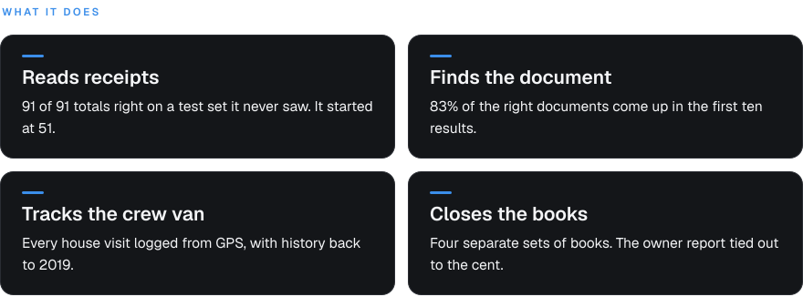
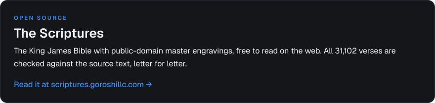

  

It reads the receipts, tracks the crew van and closes the books to the cent. I decide what it has to do, build it with AI tools, and keep only what passes a real check.

  

How it was checked: the 91 receipts were kept out of tuning; search was scored on 40 hand-checked questions; the van visits were recounted separately and matched exactly; the owner report matched a separate count. Business records and the code behind them stay private.

  
  
  
  
  
  

  

  
  
  

**Learning.** I'm working through Boot.dev's Learn Python for Beginners: 15 lessons passed, account level 25 (November 2, 2026). I write my own course code.

**Contact.** [goroshillc.com](https://goroshillc.com/) &middot; [github.com/goroshillc](https://github.com/goroshillc)

---

Colossians 3:23 · ☧ · ICXC NIKA

© 2026 Goroshi LLC. All rights reserved.

