<p align="center">
  <picture>
    <source media="(prefers-color-scheme: dark)" srcset="assets/banner-dark.svg">
    <source media="(prefers-color-scheme: light)" srcset="assets/banner-light.svg">
    
  </picture>
</p>

<div align="center">

### `SENIOR ENGINEER // PLATFORM & SYSTEMS // GOROSHI LLC`
**`AI-NATIVE` · `NEOVIM` · `ARCH LINUX` · `METAL TO BROWSER` · `SHIPS DAILY`**

**Languages**


**Infrastructure**


**Data & AI**


**AI Fleet**


</div>

---

```text
ID        :: goroshillc // JOHN 1:17 ✠ Α☧Ω
ORG       :: Goroshi LLC · Founder & Systems Engineer
EDITOR    :: Neovim. hands on home row.
OS        :: Arch Linux (Omarchy, Hyprland) · macOS
AIM       :: theosis.
AGENTS    :: 5,300+ AI agent sessions run · 3,600+ orchestrated subagents
          :: 210 sessions in a single day · 117 agents in one workflow
TOKENS    :: 98B+ tokens processed across Claude and Codex (measured Oct 16 2026)
FLEET     :: CLI: Claude Code · Codex · Gemini CLI · GitHub Copilot · OpenCode
          :: IDE & apps: Cursor · Antigravity · Claude · ChatGPT · Gemini
          :: local: Ollama · Qwen3.8 27B · Flash-Next
COMPUTE   :: Apple M5 Max · 18-core CPU · 40-core GPU · 128 GB unified · 8 TB SSD
          :: GPUs: NVIDIA RTX 5080 · RTX 5070 (Blackwell) · RTX 4090 · RTX 4080 (Ada) · RTX 3080
          :: 80+ TB storage & backup across all nodes
          :: private Tailscale mesh across every node
          :: expanding.
SCALE     :: 459 Rust crates in one workspace · 219 repositories
OUTPUT    :: 2,275 contributions in the last year across 211 repositories
SOURCE    :: private. architecture reviews and live walkthroughs on request.
STATUS    :: ACTIVE PRODUCTION // OPEN TO SENIOR ENGINEERING ROLES & PLATFORM ENGAGEMENTS
```

### `01 // PRODUCTION SYSTEMS` (private repositories)

| SYSTEM | ARCHITECTURE & SCOPE | STACK |
| :--- | :--- | :--- |
| **Multi-Agent Engineering Harness** | Parallel AI coding agents on isolated lanes across WezTerm. Cross-family review: the model family that writes a change does not approve it. Every commit passes `cargo fmt`, `clippy::pedantic -D warnings`, the test suite and a secret and personal-data scan before it lands. | `Rust` · `Git` · `WezTerm` |
| **Financial & OCR Reconciliation Engine** | Monthly sales packets, statement and receipt OCR, reconciled to the exact cent in `i64` with zero floating-point drift; every number traces back to its source page. | `Rust` · `DataFusion` · `redb` · `OCR` |
| **Proven Money** | `Lean 4` specification of the currency core: cents conserved across N-way splits, half-up rounding bounds, no `i64` overflow. Machine-checked proofs underway; target year-end 2026. | `Lean 4` · `Rust` |
| **Field Operations & Property Platform** | Rental property operations: work orders, labor-hour ledgers, receipts and expenses on embedded ACID transactional storage. | `Rust` · `redb` |

### `02 // DOCTRINE`

```text
01. MEASURE BEFORE CLAIMING   :: working code and a verified result are different states.
                                 done means it ran and was checked against ground truth.
02. ADVERSARIAL VERIFICATION  :: the model family that writes a change never approves it.
                                 compiler, lint and privacy gates fail closed.
03. ZERO-FLOAT LEDGERS        :: money is i64 integer cents, being proven in Lean 4.
                                 floating point is forbidden on financial paths.
04. SCAR-DRIVEN AUTOMATION    :: every bug becomes a regression test.
                                 every repeated failure becomes a permanent gate.
05. SHIP DAILY                :: small verified increments, every day, no unverified merges.
```

---

<div align="center">

**[goroshillc.com](https://goroshillc.com/) · [LinkedIn](https://www.linkedin.com/in/stefano-theofanous) · contact@goroshillc.com**

**`Colossians 3:23` · `Psalm 144:1`**

`☦︎ ICXC NIKA ☦︎`

</div>
